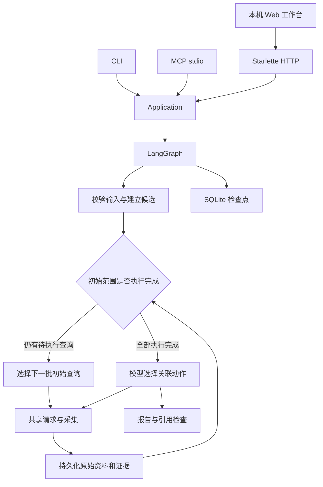

# 执行与证据结构

## 共用采集

Web、CLI 与 MCP 共用任务服务。Web 生命周期创建一个 `Application` 实例，HTTP 请求返回任务标识后，后台执行由相同的 LangGraph 流程管理。历史分页、研究详情和原始资料读取也通过应用层提供。页面资源随 Python 包分发。

默认查询范围包含全部已适配用户名条目和全部邮箱查询站点，并根据输入类型建立动作。初始动作每批执行 50 项，决策记录的 `source` 为 `catalog`；模型只安排后续关联查询，决策记录的 `source` 为 `model`。初始采集批次数不占用模型规划轮数。任务状态和报告通过 `coverage` 显示初始动作的计划、已执行与待执行数量。

`Site.sort_key` 同时用于目录展示和默认用户名范围排序：国内站点优先，常用国内平台随后按固定优先级排列，其余采用上游排名。每个用户名的 8,303 个适配条目全部保留，多个用户名的国内查询统一优先执行。已知主页、号码和 IP 资料在初始查询中优先处理。显式提供的 `sites` 顺序保持原样。`input_hint` 说明数字用户 ID、公开主页链接和会话要求。

Sherlock 和 Maigret 规则按站点地址、主页模板和标识符类型归并。规则保留独立名称与来源；请求指纹包含方法、URL、参数、请求体、请求头和身份范围。相同指纹在当前研究内使用同一份原始响应。结果中的 `artifact_ids` 明确表示共同来源。

公开查询按每个域名和全局并发限制执行。每次跳转重新检查目标地址，网络请求在发送前原子计入预算。账户检查使用独立会话范围，避免将不同检查的令牌和 Cookie 混用。

页面判断保留每个检测器的结果。正反证据同时出现、规则结论相互矛盾、限流和阻断分别记录。主页另提取标题、简介、语言、链接、文本信号和 `socid-extractor` 支持的资料字段。

关联候选从页面正文提取，排除导航、页眉与页脚区域。原始 HTML 保留完整内容。模型需要说明扩展其他标识符如何推进用户目标，完成明确要求的核查后可以结束研究。

邮箱能力参考 Holehe 按站点组织账户状态和字段检查的方式，各适配器依据公开交互独立实现。`email_progress` 从动作记录统计计划、返回、连接失败、阻断、执行失败和待处理数量，站点数按提供方去重；证据中的注册判断、公开头像和公开资料保持各自含义。

号码能力参考 PhoneInfoga 对本地资料与搜索建议的区分，以及 GhostTrack 的 phonenumbers 本地处理方式。`application/intake.py` 识别中国大陆手机号并规范化为 E164；`phone_metadata()` 提供号段资料与 `not_executed` 搜索建议，查询建议不产生网络请求。`phone_mentions()` 使用成熟号码匹配库在已采集的正文与 `tel:` 链接中查找已知号码，并保存准确匹配的上下文和来源。该关联表达页面包含号码，不确认号码持有人或当前通信状态。

## 状态与恢复

业务记录保存在 `research.sqlite`；LangGraph 使用 `AsyncSqliteSaver` 保存检查点。每项研究使用一个 `thread_id` 和操作系统文件锁。每个完成的采集动作先保存原始内容、校验值与证据，再完成动作记录。

LangGraph 节点重启执行时，已完成动作和请求直接读取保存的结果。模型规划也按研究轮次保存，避免重复执行已经保存的决定。未知完成状态的账户请求需要显式重新执行。

每次模型调用在发送前写入 `model_calls`，记录用途、请求参数、状态、原始返回与 token 用量。规划调用尝试次数持续计入预算，包括中断的调用。响应中没有返回用量的请求保持用量未知；状态中的 token 总数仅累计已取得的服务端用量。

运行耗时每 250 毫秒保存一次，正常结束时保存最终耗时。强制终止后，恢复依据最近一次保存的耗时继续执行剩余预算；最后一个保存周期内的时间可能没有写入。恢复准备与实际执行都使用任务文件锁，防止多个进程同时重置或执行同一任务。

取消信号通过任务标志和 asyncio 取消传播。连接失败、DNS 解析失败与请求超时立即终止对应查询，保存 `unreachable` 状态、请求地址及底层错误；非公共地址、响应大小、跳转限制和无法处理的服务端响应保存为 `blocked`，并保留拒绝原因。Cookie 由标准库 CookieJar 解析，其策略拒绝请求头无法使用的字符，并关闭对应响应。其余独立查询继续执行。恢复任务保留已经结束的查询状态。程序、配置、本地协议构造和模型输出异常保存错误后继续向调用方抛出；HTTP 限流和阻断以观察状态保存。网络预算耗尽进入报告节点，报告同时列出未完成动作。

## 模型边界

关联规划输入包括用户目标、候选动作、剩余预算和证据摘录。单次提供最多 100 项关联候选与最近 100 项证据，完整资料持续保存在数据库。报告按 50 项证据分组生成，并逐组检查引用。

模型只能选择候选 `action_id`，程序验证选择与证据引用。自然语言提取的标识符必须直接出现在用户原文中；需要标准化的复杂输入可使用结构化请求。

报告引用检查验证记录存在、原始文件校验值以及引用关系。证据是否充分支持自然语言结论由真实样本评估检验。`record_confirmation` 单独保存用户明确提供的声明和来源。

## 结果比较

比较以动作指纹为单位，分别输出新增、消失、内容变化、无法核查、没有再次查询和保持一致。已有记录本次连接失败时归入无法核查，并保留连接错误。一次请求失败或缺少后续查询不会被记为账号消失。

主页保存提取后的完整可见文字校验值，比较范围覆盖报告摘录以外的文字。新增资料表示本次取得了先前没有保存的记录，是否属于同一身份仍由关系证据分别表达。
